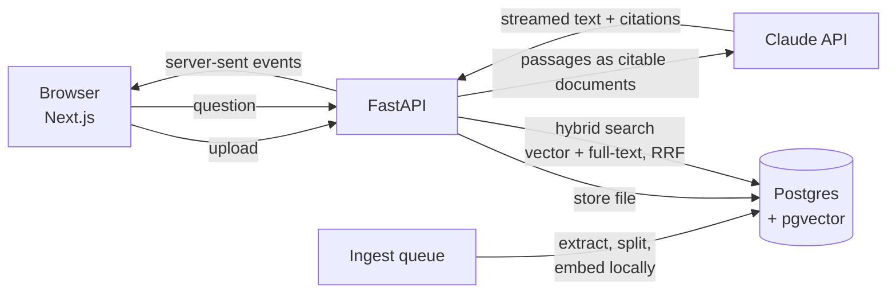

# DocuMind

**Chat with your documents, with answers you can check.** Upload PDFs, Markdown or text files and ask
questions. DocuMind finds the relevant passages with hybrid search (pgvector + Postgres full-text) and
Claude answers from them. Every claim links to the exact sentence it came from.

[](https://github.com/qaweem321/documind/actions/workflows/ci.yml)


## Features

- **Cited answers.** Uses Claude's citations feature: each claim carries a numbered marker, and
  clicking it shows the passage with the quoted sentence highlighted and a link to the file.
- **Hybrid retrieval.** Semantic search (local `bge-small` embeddings, HNSW index) and keyword search
  (Postgres full-text), merged with Reciprocal Rank Fusion in a single SQL query.
- **Streaming.** Answers appear as Claude writes them (server-sent events), with a Stop button.
- **Follow-up questions** keep the conversation's context. Chats are saved and can be reopened.
- **Scope a chat** to some documents ("only search the expense policy").
- **Upload pipeline.** Drag and drop, background processing with live status, duplicate detection by
  SHA-256, page numbers kept for PDFs, clear errors for scanned PDFs, renamed or unsupported files.
  Uploading a failed file again retries it.
- **Demo mode.** Without an API key, search and the citation UI still work: answers quote the best
  passages instead.
- **Measured retrieval.** `backend/evals/retrieval.py` scores keyword, semantic and hybrid search on
  20 questions (see [design decisions](docs/DECISIONS.md#3-why-hybrid-search-and-what-does-it-buy)).

## Quick start

You need Docker.

```bash
git clone https://github.com/qaweem321/documind.git
cd documind
echo "ANTHROPIC_API_KEY=sk-ant-..." > .env   # optional: skip it for demo mode
docker compose --profile app up -d --build
```

Open http://localhost:3600. A sample company handbook (remote work, expenses, security) is loaded on
first start, so you can ask right away: _"Can I work from Spain for two months?"_ or _"Is wine at
dinner covered?"_

Answers use `claude-opus-5-5` (set `CLAUDE_MODEL` to change it) and cost a few cents each.

## How it works



The full reasoning, with trade-offs, is in [docs/DECISIONS.md](docs/DECISIONS.md).

## Development

```bash
docker compose up -d db                  # Postgres + pgvector on port 5434
docker compose exec db psql -U documind -c "CREATE DATABASE documind_test"

cd backend                               # Python 3.12+ and uv
cp .env.example .env
uv sync
uv run uvicorn app.main:create_app --factory --reload   # http://localhost:8000/docs

cd frontend                              # in a second terminal
npm ci
npm run dev                              # http://localhost:3600
```

| Command (in `backend/`)                             | What it does                                 |
| --------------------------------------------------- | -------------------------------------------- |
| `uv run pytest`                                     | Unit and API tests against the test database |
| `uv run ruff check . && uv run mypy app`            | Lint and strict type checks                  |
| `DATABASE_URL=... uv run python -m evals.retrieval` | Retrieval evaluation (downloads the model)   |

| Command (in `frontend/`)            | What it does             |
| ----------------------------------- | ------------------------ |
| `npm test`                          | Vitest + Testing Library |
| `npm run lint && npm run typecheck` | ESLint and TypeScript    |

Commits follow [Conventional Commits](https://www.conventionalcommits.org/), checked by commitlint in a
husky hook (run `npm ci` in the repository root once).

## Configuration

Backend environment variables:

| Variable                       | Default                  | Notes                                          |
| ------------------------------ | ------------------------ | ---------------------------------------------- |
| `DATABASE_URL`                 | (required)               | Postgres with the `vector` extension available |
| `ANTHROPIC_API_KEY`            | (empty: demo mode)       |                                                |
| `CLAUDE_MODEL`                 | `claude-opus-5-5`        |                                                |
| `CLAUDE_EFFORT`                | `medium`                 | `low` answers faster, `high` thinks longer     |
| `EMBEDDING_MODEL`              | `BAAI/bge-small-en-v1.5` | Any fastembed model with 384 dimensions        |
| `CHUNK_SIZE` / `CHUNK_OVERLAP` | `500` / `100`            | Characters per passage                         |
| `TOP_K`                        | `8`                      | Passages sent with each question               |
| `MAX_UPLOAD_MB`                | `20`                     |                                                |
| `CHAT_RATE_LIMIT_PER_MINUTE`   | `20`                     | Questions per minute per client IP             |
| `SEED_EXAMPLES`                | `false`                  | Load the sample handbook into an empty library |

The frontend needs `BACKEND_URL` at build time (default `http://localhost:8000`). It proxies `/api`
there and reads the backend's settings on the server, so the first page already shows demo mode.

DocuMind has no user accounts: run it on a private network or behind your single sign-on proxy.
The chat rate limit counts each visitor separately when that proxy adds the visitor's address to
`X-Forwarded-For` (Caddy and nginx do): the Compose file lets the backend trust that header from the
frontend container only (`FORWARDED_ALLOW_IPS`). Exposed directly on port 3600, all visitors share
one limit.

## Tech

Python 3.13, FastAPI, psycopg 3, pgvector, fastembed (ONNX), LangChain text splitters, pypdf, Anthropic
SDK · Next.js 16, React 19, TanStack Query, Tailwind CSS 4 · pytest, Vitest, Testing Library · ruff,
mypy (strict), ESLint, Prettier, commitlint · Docker, GitHub Actions.

## Maintenance

DocuMind is maintained in my spare time. Security reports come first; other issues and pull requests are
welcome, but replies may take a while.

## License

MIT
